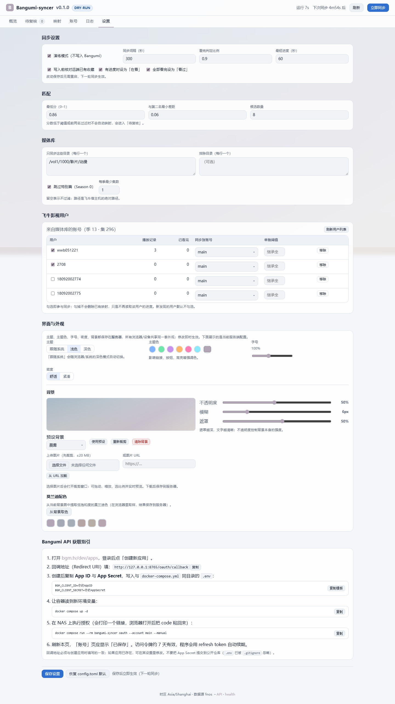
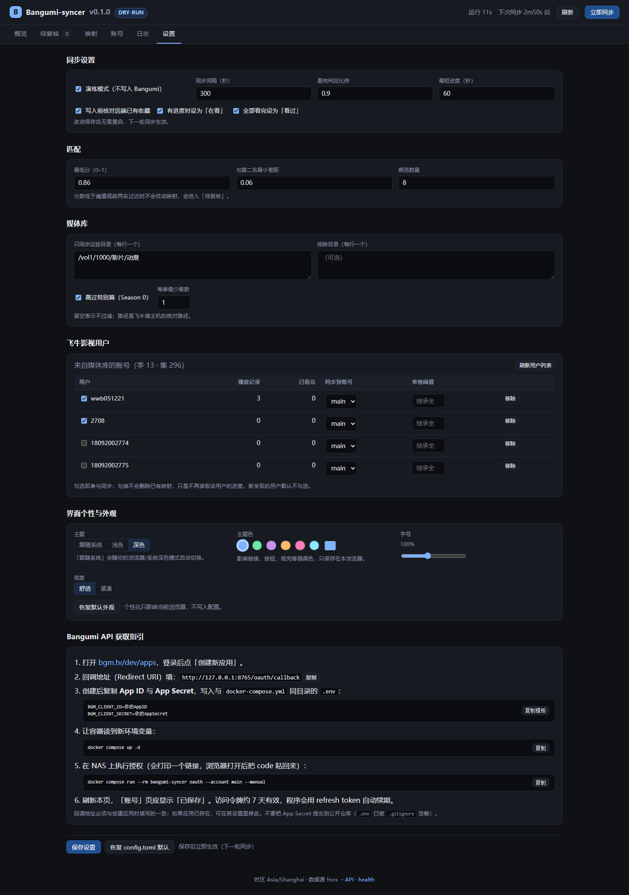
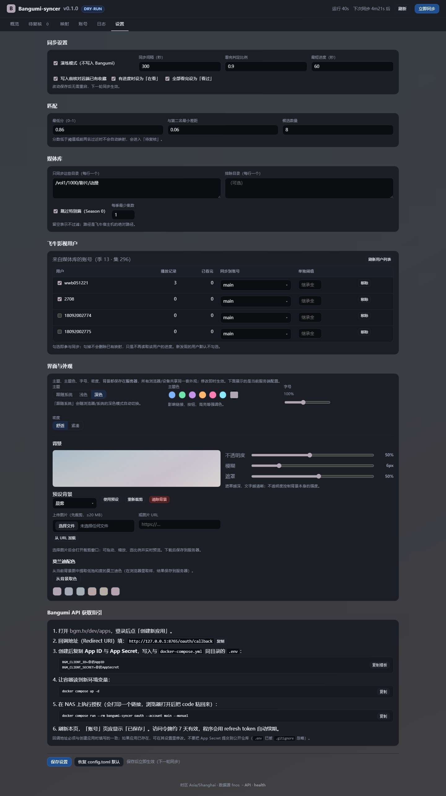
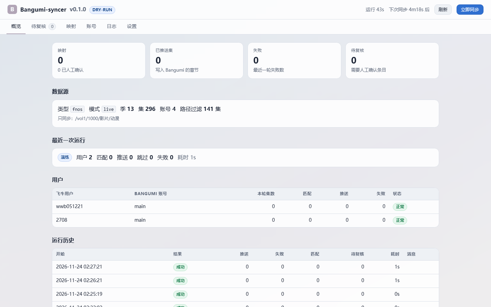

# Bangumi-syncer

> Sync **fnOS (飞牛影视, `trim.media`)** anime watch progress to **Bangumi**.
> Multi-user, read-only data source, dry-run by default, human-reviewable matching —
> in a single zero-dependency container.

[](https://github.com/wwb051221/Bangumi-syncer/actions/workflows/ci.yml)
[](LICENSE)
[](pyproject.toml)

中文文档：[README.md](README.md) · Design notes: [architecture](docs/architecture.md) ·
[matching](docs/mapping.md) · [fnOS schema](docs/schema.md) · [HTTP API](docs/api.md) ·
[verification log](docs/verification.md)

## How it works

```
┌─────────────────────┐        ┌──────────────────┐        ┌─────────────────┐
│ fnOS trim.media     │  ro    │  Bangumi-syncer  │ HTTPS  │   api.bgm.tv    │
│ trimmedia.db ───────┼───────▶│ snapshot → match │───────▶│ episode marks / │
│ (root 700, closed)  │ VACUUM │ → idempotent push│ OAuth  │ collection state│
└─────────────────────┘  INTO  └──────────────────┘        └─────────────────┘
```

The fnOS player often leaves `watched = 0` even when you finished an episode, so the
position/runtime ratio is the primary "finished" signal (`sync.watch_ratio`, default 90%).

## Features

- **Anime only** — filters by library path (`source.include_paths`), so dramas, movies and
  live channels never reach the matcher.
- **Multi-user** — every fnOS account is synced separately and can target its own Bangumi account.
- **Never writes the server DB** — a consistent copy is taken with `VACUUM INTO` over a
  read-only connection; playback is not interrupted.
- **Dry-run by default** — `app.dry_run = true` only logs what it *would* push.
- **Idempotent** — an episode is never pushed twice; optionally verifies Bangumi's own marks first.
- **Reviewable** — low-confidence matches are queued instead of guessed (`bangumi-syncer review`,
  `bangumi-syncer map add`).
- **Merged seasons** — map local episodes 25–48 to a second Bangumi subject with `--from/--to`.
- **Schema-drift tolerant** — required columns are probed, and the SQL can be overridden in config.
- **Zero runtime dependencies** — stdlib only, ~120 MB image (the python:slim base
  accounts for almost all of it).

## Quick start

```bash
git clone https://github.com/wwb051221/Bangumi-syncer.git
cd Bangumi-syncer
cp config.example.toml config.toml
```

1. Log in at <https://bgm.tv>, then create an application at <https://bgm.tv/dev/app>:
   name `Bangumi-syncer`, homepage `https://github.com/wwb051221/Bangumi-syncer`, type **application**
   (not widget), leave cross-origin unchecked. After creating it, set the redirect URI to
   `http://127.0.0.1:8765/oauth/callback` and copy the App ID / App Secret.
2. Fill in `[[target.accounts]]` (`client_id`, `client_secret`) and `[[users]]` in `config.toml`.
3. Authorise (token is stored in `/data/state/state.db`, refreshed automatically):

   ```bash
   docker compose run --rm bangumi-syncer oauth --account main --manual
   ```

4. Rehearse one run with `dry_run = true`:

   ```bash
   docker compose run --rm bangumi-syncer run --once
   ```

5. Set `app.dry_run = false`, then `docker compose up -d`. Status page: `http://<nas>:8099/`.

### Without Docker

```bash
pip install .
bangumi-syncer --config config.toml run --once
```

The process needs read access to `trimmedia.db` (root, or `source.mode = "snapshot"` with a
copy prepared elsewhere).

### Build it yourself

```bash
docker build -t bangumi-syncer .
# registry mirror (e.g. behind the GFW), either way:
docker build --build-arg BASE_IMAGE=docker.fnnas.com/library/python:3.12-slim -t bangumi-syncer .
echo 'BASE_IMAGE=docker.fnnas.com/library/python:3.12-slim' > .env   # for docker compose
```

## Multi-user

```toml
[[target.accounts]]
name = "me"
client_id = "..."
client_secret = "${BGM_CLIENT_SECRET}"

[[users]]
fnos_user = "wwb051221"   # fnOS username or guid
account = "me"

[[users]]
fnos_user = "2708"
account = "kids"
watch_ratio = 0.95
```

```bash
bangumi-syncer oauth --account me
bangumi-syncer oauth --account kids
```

## Manual review and mappings

```bash
bangumi-syncer review                          # shows without a confident match + top candidates
bangumi-syncer search -k "茶啊二中"             # find a subject id
bangumi-syncer map list
bangumi-syncer map add --account main --series 'fnos:<guid>:s1' --subject 148295
bangumi-syncer map add --account main --series 'fnos:<guid>:s1' --subject 486347 --from 25 --to 48
```

Mappings are scoped to `(account, series, episode range)`; a change clears the push history of
that range so the next run re-pushes it.

Matching is conservative on purpose: title similarity + year + episode count + season marker,
and a subject is only auto-mapped when it beats the runner-up by `match.min_margin`. Everything
else waits for a human — a wrong mapping writes wrong history, a missing one just waits.

## Web UI

Open `http://<nas>:8099/` after the container starts:

- **Overview** — uptime, source statistics, per-user results of the last run, run history.
- **Review** — shows without a confident match; pick a candidate, set an episode range
  (for merged seasons) and save the mapping right there.
- **Mappings** — create/override/delete mappings, search Bangumi by keyword, see push counters.
- **Accounts** — token state and expiry, copy-paste authorisation command.
- **Logs** — last 400 log lines, refreshed every 2 s.
- **Settings** — edit sync/match/library/user settings online (persisted in the state DB, applied
  on the next cycle **without a restart**). The media-library filter is a **visual folder tree**
  built from the real episode paths in the fnOS database: tick a parent folder to include everything
  below it, exclude subfolders, see season/episode counts per folder, and add paths manually.
  A step-by-step Bangumi API guide is included too, and **Bangumi authorization can be completed
  in the browser** (App ID/Secret, authorize link, paste the callback code) without SSH or editing
  `.env`; the CLI guide remains available for reference.
- **Appearance** (stored server-side, shared by every device) — auto/light/dark theme, six accent
  colours plus a custom picker, 85–125% font scale, comfortable/compact density; custom background
  via **upload (with crop dialog) / image URL / four built-in gradient presets** with opacity, blur
  and scrim controls, and **Morandi palette extraction from the background** that can be applied as
  the accent colour. The crop dialog supports drag, wheel/slider zoom, 16:9 / 21:9 / 4:3 / 1:1 and
  live previews of both the crop and the resulting page.

The **Sync now** button in the header wakes the loop immediately (≤0.5 s).

The first visit asks you to create an administrator account; every page and API requires login
afterwards. Passwords are PBKDF2 hashes in the state database and sessions are signed cookies valid
for 7 days. Admins can add members and reset passwords under **Settings → 登录与用户**; every user
can change their own password. Write endpoints require the `X-Requested-With` header, so a cross-site form cannot call
them. See [docs/api.md](docs/api.md). The SPA is plain JavaScript with **no build step**.

### Screenshots

| Settings (light) | Settings (dark) |
| --- | --- |
|  |  |

Custom background with a Morandi accent extracted from it:

| Dark | Light |
| --- | --- |
|  |  |

Appearance is stored server-side, so every device shares it. Backgrounds can be uploaded, loaded
from a URL or picked from four built-in gradient presets, with opacity/blur/scrim controls.
Responsive down to 320 px wide.

## Commands

```
bangumi-syncer run [--once]        # loop (container default) or one shot
bangumi-syncer status              # recent runs, tokens, counters
bangumi-syncer review [--json]     # unmatched shows with candidates
bangumi-syncer map list|add|remove # season -> subject mappings
bangumi-syncer search -k KEYWORD   # look up Bangumi subject ids
bangumi-syncer oauth --account X   # authorise (--manual works over SSH)
bangumi-syncer dump [--json]       # what the media server reports, no writes
```

Exit codes: `0` ok, `1` run failed, `2` config error, `3` re-authorisation needed.

## Security

- The trim.media database is mounted **read-only**; only a copy is written, to our own volume.
- The container runs as root because the database is `root:700`. Prefer `source.mode = "snapshot"`
  with a host cron if you want to run unprivileged.
- Tokens live in `/data/state/state.db`, never in the config file; the config can be mounted read-only.
- No telemetry. Outbound traffic is limited to `api.bgm.tv` / `bgm.tv`.
- The status page is read-only; every mutation goes through the CLI.

## Development

```bash
pip install -e ".[dev]"
python -m pytest        # 176 offline tests (synthetic fnOS DB + fake tracker)
ruff check src tests
```

Layout and extension points (adding Jellyfin/Emby/Plex sources) are documented in
[docs/architecture.md](docs/architecture.md).

## License

[MIT](LICENSE). Not affiliated with fnOS or Bangumi; please respect the Bangumi API terms —
the default rate limit is one request per second.
